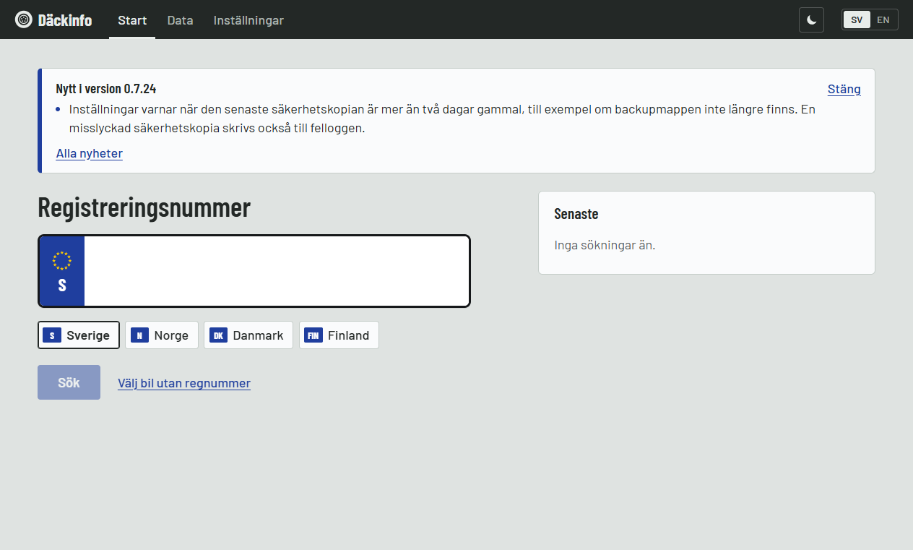
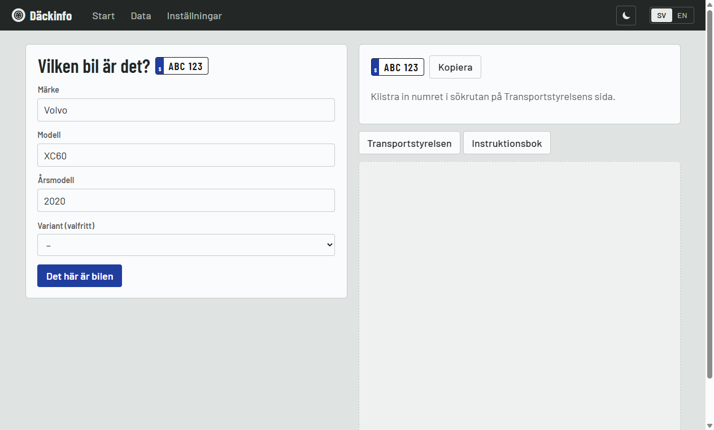
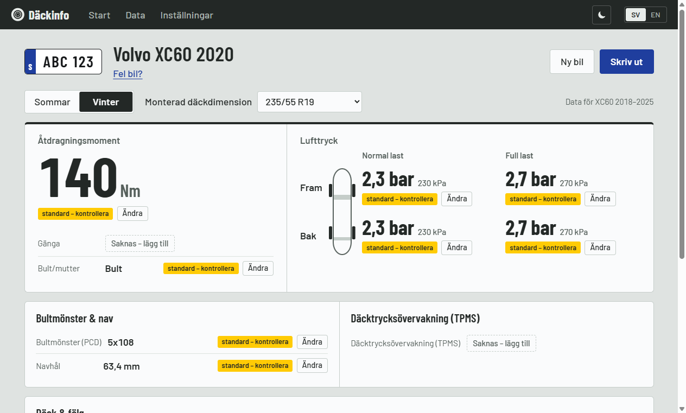
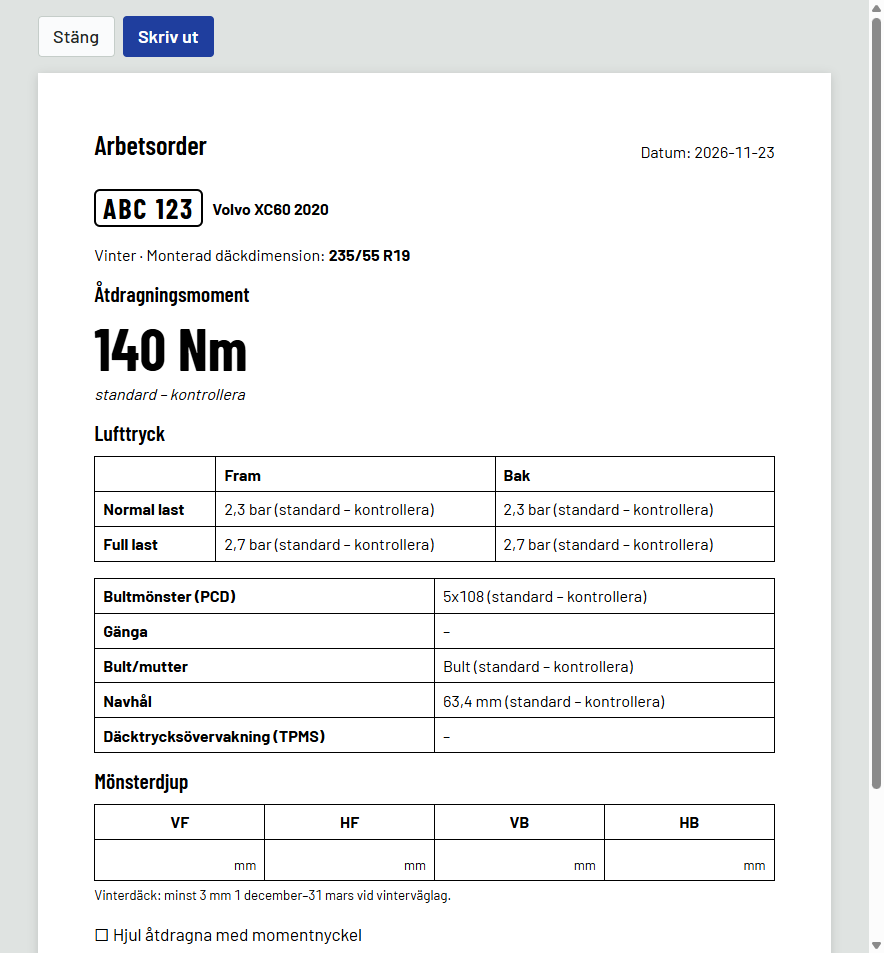

# Däckinfo

Däckinfo är ett program för däckverkstaden. Skriv in bilens registreringsnummer och få direkt
**åtdragningsmoment, lufttryck, bultmönster och navhål**, och skriv ut en arbetsorder till mekanikern.

Programmet körs på verkstadens Windows-dator. Surfplattor i verkstaden kan använda det via datorn.

**Innehåll**

- [Installera](#installera)
- [Så använder du Däckinfo](#så-använder-du-däckinfo)
- [Surfplattor i verkstaden](#surfplattor-i-verkstaden)
- [Säkerhetskopior](#säkerhetskopior)
- [Uppdateringar](#uppdateringar)
- [Om något inte fungerar](#om-något-inte-fungerar)

---

## Installera

1. Öppna **[den senaste versionen](https://github.com/Kizburb/dackinfo-releases/releases/latest)**. Ladda ner
   filen `Dackinfo-Setup-…exe` under *Assets*.
2. Dubbelklicka på filen.
3. Windows kan visa **”Windows skyddade datorn”** eftersom programmet inte är signerat med ett köpt certifikat.
   Klicka på **Mer information** och sedan **Kör ändå**.
4. Följ installationsguiden. Windows frågar om administratörsgodkännande, eftersom Däckinfo installeras för alla
   användare på datorn.

Däckinfo startar sedan av sig självt när datorn startar. Programmet ligger som en ikon nere till höger vid klockan.
Om du stänger fönstret fortsätter Däckinfo att köra i bakgrunden, så att surfplattorna fungerar. Klicka på ikonen
för att öppna fönstret igen.

---

## Så använder du Däckinfo

### 1. Skriv in registreringsnumret

Välj land (**Sverige**, Norge, Danmark eller Finland). Skriv numret och tryck **Enter** eller **Sök**.

- Under **Senaste** syns bilarna du nyss sökt på. Klicka på en för att öppna den igen.
- Har bilen ingen skylt? Klicka på **Välj bil utan regnummer** och välj märke, modell och årsmodell.

### 2. Välj vilken bil det är (bara första gången)

Första gången du söker på ett svenskt nummer frågar Däckinfo vilken bil det är:

1. Till höger visas **Transportstyrelsens** sida. (I bilden ovan är den tom, men i programmet visas den där.)
2. Klicka på **Kopiera** och klistra in numret i sökrutan på Transportstyrelsens sida.
3. Läs av märke, modell och årsmodell där. Välj samma sak i listorna till vänster.
4. Klicka på **Det här är bilen**.

Däckinfo kommer ihåg bilen. Nästa gång du söker på samma nummer kommer du direkt till steg 3.

För norska och danska nummer kan Däckinfo hämta bilen automatiskt. Det kräver en API-nyckel under
**Inställningar → API-nycklar**.

### 3. Läs av värdena

- **Sommar / Vinter**: välj säsong.
- **Monterad däckdimension**: välj dimensionen som sitter på bilen. Lufttrycket visas för just den dimensionen.
  Finns den inte i listan väljer du **Annan dimension…** och skriver in den.
- **Åtdragningsmoment**: det stora talet. På vissa bilar visas två rader, en för **stålfälg** och en för
  **aluminiumfälg**.
- **Lufttryck**: fram och bak, både vid **normal last** och **full last**, i bar och kPa.
- **Bultmönster och navhål**: längre ner på sidan.

**Vad betyder märkningarna?**

| Märkning | Betyder |
|---|---|
| **standard – kontrollera** (gul) | Värdet kommer från biltillverkarens instruktionsbok eller annan källa och har inte kontrollerats av er ännu. Jämför med bilens egen dokumentation om du är osäker. |
| **Kontrollerad** | Någon i verkstaden har bekräftat värdet. |
| **Saknas – lägg till** | Värdet finns inte. Klicka och skriv in det, till exempel från bilens dörrstolpe eller tanklock. |

Med **Ändra** rättar du ett värde. Du skriver då in dina initialer, så att det syns vem som ändrade.

Har modellen flera versioner med olika värden, till exempel en laddhybrid? Då visas knappar under **Version**. Välj
den som stämmer med bilen.

### 4. Skriv ut arbetsordern

Klicka på **Skriv ut**. En förhandsvisning öppnas. Klicka på **Skriv ut** igen, eller tryck **Ctrl+P**.

Arbetsordern får plats på ett A4-ark och innehåller inga kunduppgifter. Mekanikern fyller i mönsterdjupet och
bockar av när hjulen är åtdragna med momentnyckel.

### 5. Nästa bil

Klicka på **Ny bil** (eller tryck **Esc**) för att komma tillbaka till startsidan.

---

## Surfplattor i verkstaden

Surfplattor och mobiler i verkstaden kan använda Däckinfo via datorn. De måste vara anslutna till samma nätverk
(wifi) som datorn. Gör så här en gång per surfplatta:

**På datorn**

1. Windows måste räkna nätverket som **Privat**, annars stoppar brandväggen surfplattorna. Gå till
   *Windows Inställningar → Nätverk och internet → ditt nätverk (wifi eller Ethernet) → Nätverksprofil: **Privat***.
   Däckinfo visar en röd varning under *Inställningar → Nätverk* om nätverket inte är privat.
2. Öppna **Inställningar** i Däckinfo. Kontrollera att **Andra enheter får använda Däckinfo** är ikryssat.

**På surfplattan**

3. Skanna QR-koden som visas under *Inställningar → Nätverk* på datorn, eller skriv in adressen som står där.
4. Följ stegen på sidan som öppnas. Den visar hur du installerar verkstadens certifikat på just din sorts enhet
   (iPad/iPhone eller Android). Det görs bara en gång per surfplatta. Därefter är anslutningen krypterad.

**Parkoppla**

5. På datorn: gå till *Inställningar → Enheter* och klicka på **Parkoppla ny enhet**. En sexsiffrig kod visas.
   Koden gäller i 10 minuter.
6. På surfplattan: skriv in koden och ett namn på surfplattan, till exempel ”Verkstad 1”. Tryck på **Parkoppla**.

Klart. Surfplattan fungerar så länge datorn är igång och Däckinfo körs. Däckinfo hindrar datorn från att gå i
viloläge medan surfplattor är parkopplade. Skärmen kan fortfarande släckas. En surfplatta som inte längre används
tar du bort under *Inställningar → Enheter*.

---

## Säkerhetskopior

Däckinfo gör en **säkerhetskopia varje dag** och sparar de senaste 14. Allt finns under
*Inställningar → Säkerhetskopior*:

- **Byt mapp…**: spara kopiorna på ett annat ställe, till exempel en USB-disk eller nätverksmapp. Det rekommenderas,
  så att kopiorna finns kvar om datorn går sönder.
- **Exportera…**: spara en kopia var du vill, till exempel inför byte av dator.
- **Importera…**: läs in en kopia, till exempel på en ny dator.
- **Återställ**: gå tillbaka till kopian från ett visst datum.

Om den senaste kopian är mer än två dagar gammal visas en varning. Kontrollera då att mappen finns och att det går
att skriva till den.

---

## Uppdateringar

Gå till *Inställningar* och klicka på **Sök efter uppdatering**. Finns en ny version klickar du på **Installera**.
Däckinfo säkerhetskopierar databasen, stänger och startar om. Windows frågar om administratörsgodkännande.

Du kan också kryssa i **Sök efter uppdateringar automatiskt (en gång per dag)**. Däckinfo installerar aldrig något
utan att du klickar. Varje uppdatering kontrolleras med en digital signatur innan den installeras.

Vad som är nytt i varje version syns på startsidan under **Nytt i version …** och under *Alla nyheter*.

---

## Om något inte fungerar

| Problem | Gör så här |
|---|---|
| Surfplattan når inte Däckinfo | Kontrollera att datorn är igång och att Däckinfo körs (ikonen vid klockan). Kontrollera också att surfplattan är på samma wifi och att nätverket är **Privat** i Windows (se ovan). |
| Surfplattan varnar för certifikatet | Gör om steg 3–4 under *Surfplattor i verkstaden*. |
| Fel bil visas | Klicka på **Fel bil?** under bilens namn och välj rätt. |
| Ett värde verkar fel | Kontrollera mot bilens dokumentation. Klicka sedan på **Ändra** och skriv in rätt värde. |
| Något annat | Fel som inträffar sparas i filen `errors.log` i mappen `logs`. Den ligger i Däckinfos datamapp, samma mapp som säkerhetskopiorna sparas i från början. Skicka med filen när du ber om hjälp. Den innehåller inga kunduppgifter. |

**Om uppgifterna:** värdena kommer från biltillverkarnas egna instruktionsböcker och officiella källor. Saknas en
säker källa lämnas värdet tomt, hellre än att gissa. Däckinfo är ett hjälpmedel. Den som utför arbetet ansvarar för
att rätt moment och lufttryck används.

**Integritet:** sökta registreringsnummer sparas bara på verkstadens dator. De raderas automatiskt efter den tid som
är vald under *Inställningar* (standard 3 år).
